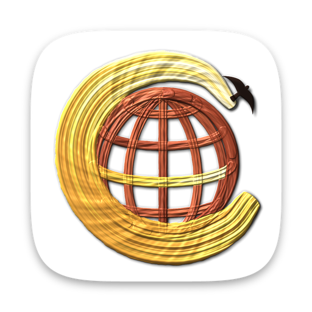

<div align="center">



<h1>Merlin</h1>

<p>A Chromium-based browser for macOS that you drive with Vim keys.</p>

<p>
  <a href="https://github.com/kylianmarceau/merlin/releases/latest"></a>
  
  
  <a href="LICENSE"></a>
</p>

<p>
  <a href="https://github.com/kylianmarceau/merlin/releases"><b>Download</b></a> ·
  <a href="#features">Features</a> ·
  <a href="#keys">Keys</a> ·
  <a href="#configuration">Configuration</a> ·
  <a href="#build-from-source">Build</a> ·
  <a href="#documentation">Docs</a>
</p>

</div>

<!-- TODO: add a screenshot of a browser window here, e.g.
<p align="center"></p>
-->

Merlin is a normal Chromium browser with a modal keyboard layer on top. You
can follow links, switch tabs, split the window, search history and edit
text fields in Neovim without reaching for the mouse. Sites, extensions,
passwords and DevTools work the same as in Chrome.

Typing in a text field always goes to the page, and any site can have its
own shortcuts back. To turn the keyboard layer off entirely, switch off
**Settings › Keys › Modal browsing**. Everything stays a click or Cmd-K
away: Cmd-K opens Merlin's menu, and dragging a tab onto the edge of the
page splits the window.

> [!NOTE]
> Merlin requires an Apple Silicon Mac and macOS 14 Sonoma or later.
> Updates are available through Homebrew or by downloading a new release.

## Install

With [Homebrew](https://brew.sh):

```bash
brew install --cask kylianmarceau/tap/merlin
```

After the first launch attempt, go to **System Settings › Privacy & Security**,
click **Open Anyway** next to Merlin, then **Open**. The app is ad-hoc signed
and isn't notarized by Apple.

Quit Merlin before updating:

```bash
brew update
brew upgrade --cask kylianmarceau/tap/merlin
```

Homebrew keeps your profile and configuration. The
[Merlin tap](https://github.com/kylianmarceau/homebrew-tap) tracks stable
releases and checks for new versions hourly; scheduled checks can be delayed.
If you already installed Merlin manually, see the tap's instructions for
letting Homebrew manage it.

You can also install the DMG directly:

1. Download the latest `Merlin-<version>-arm64.dmg` from
   [Releases](https://github.com/kylianmarceau/merlin/releases/latest).
2. Open the disk image and drag **Merlin** into **Applications**.
3. Open Merlin. macOS will block it the first time because the app isn't
   notarized by Apple.
4. Go to **System Settings › Privacy & Security**, click **Open Anyway**
   next to the message about Merlin, then **Open**.

To update a manual installation, quit Merlin and replace the app. Your
profile and config are kept. Use **Watch › Custom › Releases** on this repository to get notified
of new versions. More detail in [docs/RELEASE.md](docs/RELEASE.md).

## Features

**Modes.** Normal for moving around, Insert for typing (entered
automatically when a field is focused), Visual for selecting text, Command
for the `:` line, Hint for link labels, and Passthrough to send every key
to the site. The current mode shows in a small pill in the corner, and
nothing covers the page in Normal mode.

**Link hints.** `f` labels every link on the page and you type the label to
follow it. `F` opens in a new tab, `yf` copies the link, `gi` jumps to a
text field, and `gf` peeks at the link in a floating card over the page
(`⌘↩` keeps it as a tab; `Esc` closes it). `:peek <url>` does the same for
an address. Hints work inside iframes and web components.

**One palette.** `:` takes commands, URLs and searches. `b` switches tabs.
`?` searches every command and shows its key. Everything is fuzzy-matched,
and a which-key popup shows what follows a prefix like `g` or `<C-w>`.

**Long pages.** `gO` opens an outline of headings, code blocks and tables.
`]]` and `[[` jump between headings, `]c` between code blocks, `]t` between
tables. `gl` lists every link on the page. `yM` copies the page as
Markdown and `yc` copies a code block.

**Tabs and splits.** Tabs in a sidebar or along the top, or hidden entirely
with `⌘S`. Split the window with `<C-w>v` or `<C-w>s`. Pin tabs with `gp`.
Group tabs from a tab's menu or with `:group research` (`:ungroup` takes a
tab out); a group can be renamed, recoloured and collapsed from its header.

**Picture in picture.** A video playing with sound floats in a rounded
window when you switch tabs, and goes back when you return. Turn it off in
**Settings › General**.

**Workspaces.** Save a window with `:workspace save research` and reopen
it later with `gw`: its tabs, pins, splits, tab groups and the window's
place on screen come back. Workspaces save as you go, and your last
session comes back on launch, even after a crash. A workspace can be tied
to a project folder and reopened from that folder's terminal.

**Edit in your editor.** Press `ge` to pick a field, or `Ctrl+Shift+E`
while typing, and the text opens in Neovim or any editor you configure.
Saving writes it back to the page. Password and payment fields are never
sent out.

**Ad blocking.** On by default, using Brave's Rust filter engine: network
requests, cosmetic filters, scriptlets and popups. Turn it off per site
with `:adblock site toggle`, or everywhere in **Settings › Ad blocking**.

**Scripting.** `browserctl` controls the running browser from a terminal,
Neovim or a shell script. See [browserctl](#browserctl).

**Marks and macros.** `ma` sets a mark and `'a` returns to it. `qa` … `q`
records a macro and `@a` replays it. Counts work too, as in `5j`.

## Keys

Press `?` in the browser for the full, searchable list. `Esc` returns to
Normal mode (`Shift+Esc` in Passthrough).

| Key | Action | Key | Action |
|---|---|---|---|
| `j` `k` `h` `l` | Scroll | `gg` / `G` | Top / bottom |
| `<C-d>` / `<C-u>` | Half page down / up | `H` / `L` | Back / forward |
| `f` / `F` | Follow link / in new tab | `gi` | Focus a text field |
| `o` / `O` | Open URL or search / in new tab | `t` | New tab |
| `J` / `K` | Next / previous tab | `b` | Switch tab |
| `d` / `u` | Close tab / reopen | `r` / `R` | Reload / hard reload |
| `/` then `n` `N` | Find in page | `yy` | Copy URL |
| `gO` | Page outline | `gl` | Links on the page |
| `<C-w>v` / `<C-w>s` | Split side by side / stacked | `<C-w>o` | Close split |
| `gw` | Workspaces | `ge` | Edit field in your editor |
| `:` | Command line | `?` | Search commands and keys |

<details>
<summary><b>More keys</b></summary>
<br>

| Key | Action | Key | Action |
|---|---|---|---|
| `<C-f>` / `<C-b>` | Page down / up | `gu` / `gU` | Up one level / site root |
| `ym` | Copy Markdown link | `yf` | Copy a link |
| `yc` | Copy a code block | `yM` | Copy page as Markdown |
| `p` / `P` | Open URL from clipboard / in new tab | `gp` | Pin tab |
| `]]` / `[[` | Next / previous heading | `]c` / `[c` | Next / previous code block |
| `]t` / `[t` | Next / previous table | `<C-w>w` / `<C-w>x` | Next split / swap splits |
| `gf` | Peek at a link | `:group` / `:ungroup` | Group tab / take it out |
| `gh` / `gb` | Search history / bookmarks | `v` | Visual mode |
| `ma` / `'a` | Set / go to mark | `qa` … `q`, `@a` | Record / play macro |
| `i` | Insert mode | `<C-v>` | Passthrough mode |
| `M` | Merlin menu | `⌘S` | Hide / show tabs |

</details>

## Configuration

Merlin reads `~/.config/modal_browser/config.toml` (or
`$XDG_CONFIG_HOME/modal_browser/config.toml`). Every setting is optional.
Run `:config-reload` to apply changes without restarting. Errors are
reported with their line number and the rest of the file still loads.

```toml
[options]
tabs = "top"                  # or "side"
hint_chars = "sadfjklewcmpgh"
smooth_scroll = true
passthrough_sites = ["mail.google.com", "*.figma.com"]

# Edit fields with Neovim in Ghostty
editor = ["/Applications/Ghostty.app/Contents/MacOS/ghostty",
          "--quit-after-last-window-closed=true", "-e", "nvim", "{file}"]

[keys.normal]
"<C-n>" = "tabnext"
",g" = "open https://github.com"

[aliases]
notes = "workspace open notes"

[unmap]
normal = ["d"]                # give this key back to sites
```

Every option is documented in
[`docs/config.example.toml`](docs/config.example.toml).

### Appearance

**Settings › Appearance** has eight theme-colour presets, a custom colour
picker, full-window or accent-only tint, page-colour matching, rounded or
sharper corners, compact or comfortable spacing, start-page backgrounds,
and yellow or theme-coloured link hints. Changes apply to every open window
without restarting. Private windows keep their dark palette, and accessibility
colours retain priority.

The config options and defaults are:

```toml
[options]
theme_color = "default"             # or "#RRGGBB"
theme_tint = "full"                 # or "accent"
page_color_matching = true
corner_style = "rounded"            # or "sharp"
density = "compact"                 # or "comfortable"
start_background = "plain"          # or "gradient", "image"
hint_color = "yellow"               # or "theme"
```

Choose a PNG, JPEG or WebP in Settings for an image background. Merlin saves a
resized copy locally in `start_background_image`; it does not upload the image
or fetch it remotely. **Remove image** clears that copy.

## browserctl

`browserctl` talks to the running browser over a Unix socket that only
your user can open. There is no network listener, and private windows are
not visible to it.

```bash
scripts/install_browserctl.sh                # installs to ~/.local/bin
```

```bash
browserctl open https://docs.rs              # open in a new tab
browserctl open --current rust lifetimes     # search in the current tab
browserctl tabs --json                       # list tabs
browserctl focus --tab 3
browserctl selection                         # print the selected text
browserctl workspace here                    # open this folder's workspace
browserctl command 'vsplit https://docs.rs'  # run any : command
```

Disable it with `browserctl = false` in the config.

## Privacy

Merlin has no telemetry, no accounts and no AI features. The only network
requests it adds are filter list updates for the ad blocker, fetched over
HTTPS from EasyList and GitHub, with no browsing data attached.
[docs/PRIVACY.md](docs/PRIVACY.md) lists every file, socket and piece of
page data Merlin touches.

## Limitations

Merlin is Chromium underneath, so rendering, the sandbox, site isolation,
passwords, autofill, PDFs, DevTools and extensions behave as they do in
Chrome. Some things are missing:

- **No background app updates.** Run `brew update` and
  `brew upgrade --cask kylianmarceau/tap/merlin`, or download a new release.
  Releases include Chromium security fixes.
- **Netflix and other DRM sites open in WebKit.** Merlin's Chromium has no
  Widevine, so Netflix, Disney+, Prime Video, Spotify's web player and
  similar services open in WebKit (Safari's engine) inside the same tab,
  which plays them. WebKit keeps its own sign-ins, and those tabs have no
  modal keys, find in page or downloads. Right-click a tab to move a site
  between engines.
- **No Google Sync.** Bookmarks and passwords stay on your Mac.
- **Chrome Web Store installs may need extra steps.** Unpacked and `.crx`
  extensions work.
- **Apple Silicon Macs only.** No Intel, Windows or Linux builds.

## Build from source

This repository contains only Merlin's own code (`overlay/`) and a set of
small patches to Chromium (`patches/`). The build links them into a
Chromium checkout at the version pinned in [`UPSTREAM_PIN`](UPSTREAM_PIN).

The React Native macOS UI migration has a separate host build and assembly
step. Its architecture, manual build instructions and remaining work are in
[`apps/browser/README.md`](apps/browser/README.md).

**Requirements:** an Apple Silicon Mac, full Xcode, about 100 GB of free
disk space and 16 GB of RAM. The first checkout and build take a few hours.

```bash
# Chromium's tools
git clone https://chromium.googlesource.com/chromium/tools/depot_tools.git ~/depot_tools
export PATH="$PATH:$HOME/depot_tools"

# Merlin
git clone https://github.com/kylianmarceau/merlin.git
cd merlin

# Check the machine, then fetch Chromium at the pinned version
scripts/bootstrap_chromium.sh
scripts/bootstrap_chromium.sh --fetch

# Link Merlin into the checkout and apply patches
scripts/apply_overlay.sh
~/chromium/src/third_party/cpython3/host/bin/python3 scripts/prepare_adblock_deps.py --src ~/chromium/src
python3 scripts/prepare_adblock_resources.py

# Build and run
cd ~/chromium/src
gn gen out/Modal
autoninja -C out/Modal chrome
open out/Modal/Merlin.app
```

Chromium is checked out to `~/chromium` by default. Set `CHROMIUM_DIR` to
use another path (it can't contain spaces). Release builds and packaging
are covered in [docs/RELEASE.md](docs/RELEASE.md).

### Development

```bash
scripts/check.sh               # formatting, lints, Rust and C++ tests, patch checks
scripts/run_browser_tests.sh   # headless ad-block browser tests inside Chromium
scripts/run_e2e_tests.sh       # end-to-end tests against the real Merlin.app, in the background
pnpm ui:check && pnpm ui:test  # React shell type and architecture checks
scripts/check_upstream.py      # check for a newer Chromium security release
cargo run -p modalctl          # try the modal core in a terminal, no Chromium needed
```

The Rust core (modes, keymaps, commands, config, hints, workspaces) builds
and tests with plain `cargo`, without a Chromium checkout.

| Path | Contents |
|---|---|
| `overlay/components/modal_browser/` | Rust core and its C++ bridge |
| `overlay/chrome/browser/ui/modal_browser/` | Modal controller, the React window and its engine bridge, config, preferences |
| `apps/browser/`, `packages/` | The React Native macOS shell: tabs, toolbar, address field, command menu, Settings, Library |
| `overlay/components/merlin_adblock/` | Ad blocking engine bridge and offline filter data |
| `overlay/chrome/browser/merlin_adblock/` | Ad blocking service, request interception and list updates |
| `overlay/chrome/renderer/merlin_adblock/` | Scriptlets and cosmetic filtering in the page |
| `patches/` | Edits to Chromium's own files, one small patch each |
| `tools/` | `browserctl`, `modalctl` and a fake-browser test harness |
| `tests/e2e/` | End-to-end tests that drive an assembled Merlin.app ([how they work](tests/e2e/README.md)) |
| `branding/` | Name, icons and colors |
| `scripts/` | Setup, build, test and packaging |

## Documentation

| | |
|---|---|
| [Architecture](docs/ARCHITECTURE.md) | How the layers fit together and where Merlin hooks into Chromium |
| [Decisions](docs/DECISIONS.md) | What was chosen, why, and the trade-offs |
| [Testing](docs/TESTING.md) | Test suites, results and the manual test plan |
| [Release](docs/RELEASE.md) | Building, packaging and installing a release |
| [Release notes](docs/RELEASE_NOTES.md) | Requirements and known issues for the current beta |
| [Upstream](docs/UPSTREAM.md) | The pinned Chromium version, every patch, and how updates work |
| [Performance](docs/PERFORMANCE.md) | Startup, memory and page load compared with Brave and Dia |
| [Privacy](docs/PRIVACY.md) | Every file, socket and piece of page data Merlin touches |
| [Ad blocking](docs/ADBLOCK_IMPLEMENTATION.md) | How the native blocker works and how it was tested |
| [Visual identity](docs/VISUAL_IDENTITY.md) | Merlin's UI changes, with screenshots and checks |

## Contributing and issues

Bug reports are welcome. Please include the version from
`chrome://version`, steps to reproduce, and whether stock Chromium at the
same version does the same thing. Report security problems privately as
described in [SECURITY.md](SECURITY.md), not in a public issue.

## License

Merlin's code is released under the [BSD 3-Clause License](LICENSE).
Chromium and other bundled software keep their own licenses, listed in the
third-party notices shipped with each release.

Merlin is built on [Chromium](https://www.chromium.org/), and its keyboard
model borrows heavily from Vim, Neovim, Vimium, qutebrowser and Tridactyl.
